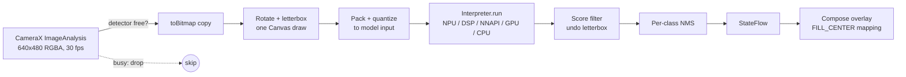
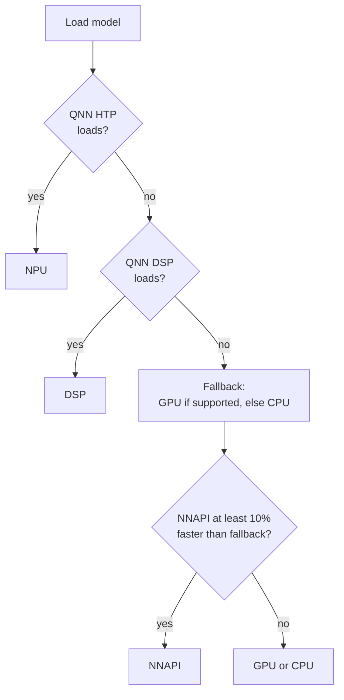

# ObjectScanner

Real-time, on-device object detection for Android.

It runs a YOLOv8 model on the camera feed and draws labeled boxes over the preview. On Snapdragon phones it uses the NPU. Everywhere else it falls back to the DSP, NNAPI, GPU or CPU, picking the fastest one that works.

No network calls. No cloud. Every frame stays on the device.

---

## Highlights

- **NPU first, on any API level.** Uses Qualcomm AI Engine Direct (QNN) through the LiteRT delegate, so the NPU works below Android 12 too.

- **Five-tier backend chain.** QNN HTP (NPU), QNN DSP, NNAPI, GPU, CPU. Each tier is tried in order, and failures fall through cleanly.

- **NNAPI is measured, not trusted.** It is used only if it beats the GPU (or CPU) by at least 10% in a one-time probe.

- **Bounded latency.** At most one frame in flight. Frames that arrive while busy are dropped, never queued.

- **Compiled-model caching.** NPU, DSP, NNAPI and GPU programs are cached in `codeCacheDir`.

- **Modern stack.** Kotlin, Jetpack Compose, CameraX, LiteRT 1.4.2.

---

## Verified devices

Tested October 2026.

| Device | SoC | Android | Runs on | Measured |
|---|---|---|---|---|
| Motorola Edge 50 Pro | Snapdragon 7 Gen 3 (Hexagon HTP V73) | 16 | **NPU** (QNN HTP) | All 280 of 280 nodes on the HTP. **27 to 32 ms per frame**, including CPU pre and post processing. |
| Samsung Galaxy M31 | Exynos 9611 (no NPU) | 12 | **GPU** | QNN skipped cleanly. NNAPI probe lost: **148.6 ms vs 66.5 ms** on GPU. |

The two numbers above measure different things:

- **Moto:** full per-frame detector time (letterbox, quantize, inference, NMS).

- **Galaxy:** model-only probe median on a blank input.

---

## Architecture

### Frame pipeline



### Threads

| Thread | Owns | Notes |
|---|---|---|
| Main | Compose UI, CameraX binding | Draws boxes from `StateFlow`. |
| Camera analysis executor | `ImageProxy` to `Bitmap` | Skips the bitmap copy when the detector is busy. |
| Detector executor (single thread) | Interpreter, delegates, I/O buffers | The GPU delegate must be created and run on the same thread. The interpreter never leaves it. |

### Backend selection



Rules:

- **QNN wins whenever it loads.** It only loads on Snapdragon chips it supports.

- **NNAPI can't say which chip it runs on.** So it has to prove itself in a probe: median of 5 runs after 1 warm-up, against the fallback.

- **Probe verdict is cached** in SharedPreferences, keyed by `Build.FINGERPRINT` + model. It reruns only after an OS update or model change.

- **Crash guard.** Some NNAPI drivers crash the process while compiling. A "lost" verdict is written with `commit()` *before* the probe, so a crash is never retried.

- **NNAPI needs API 27+.** Devices on API 26 skip it.

- **`useNnapiCpu(false)`.** NNAPI's slow reference CPU path is never used.

---

## Design decisions

| Decision | Why | Trade-off |
|---|---|---|
| LiteRT 1.4.2 `Interpreter` + QNN delegate | NPU on any API level. The LiteRT 2.x `CompiledModel` NPU path needs API 31+. | Older API. About 200 MB of Qualcomm native libraries. |
| No TFLite Task Library | This model has no TFLite metadata and emits raw YOLO outputs, not SSD outputs. | The app owns pre-processing, decoding and NMS. |
| NNAPI only if 10% faster | NNAPI often runs slower than the GPU on older drivers (see Galaxy M31). The margin stops noise from flipping the choice. | One-time probe cost per OS build. |
| Single detector thread | GPU delegate thread affinity. | No overlap between frames. |
| Drop frames, never queue | Boxes always match a recent frame. | Effective FPS drops on slow backends. |
| 4:3 preview and 4:3 analysis | Same field of view, so the overlay is one scale plus a centered crop. | Not full-sensor 16:9 preview. |
| 640x480 RGBA analysis | Close to the 640x640 model input. `toBitmap()` is a plain copy. | Small objects get fewer pixels. |
| Rotate + letterbox in one `Canvas` draw | One pass through a `Matrix`, no temp bitmaps. | Uses a reusable bitmap the size of the model input. |
| Outputs matched by shape, name, then type | Tensor order differs between exports. | Assumes exactly 3 outputs. |

---

## Model

The bundled model is a Qualcomm AI Hub export of **YOLOv8 detection** (`yolov8_det`), 8-bit quantized, trained on the 80 COCO classes.

| Tensor | Shape | Meaning |
|---|---|---|
| Input | 640x640 RGB (NHWC or NCHW) | Values 0 to 1, letterboxed with gray (114, 114, 114) |
| `boxes` | `[1, N, 4]` | `x1, y1, x2, y2` in input pixels |
| `scores` | `[1, N]` | Best class score per candidate |
| `class_idx` | `[1, N]` | COCO class id |

There is no NMS inside the model. The app does per-class greedy NMS.

### Swapping the model

1. Export `yolov8_det` (or another model with the same outputs) from [Qualcomm AI Hub Models](https://github.com/quic/ai-hub-models) as TFLite.

2. Put it in `app/src/main/assets/` and update `modelPath` / `labelsPath` in `ObjectDetectorOptions`.

3. Use an **8-bit quantized** model. The HTP runs in quantized precision. A float model fails on the NPU and falls through to the GPU.

---

## Configuration

`ObjectDetectorOptions` in `ObjectDetectorHelper.kt`:

| Option | Default | Effect |
|---|---|---|
| `modelPath` | `object_detector.tflite` | Model file in `assets/` |
| `labelsPath` | `coco_labels.txt` | One label per line, indexed by class id |
| `scoreThreshold` | `0.5` | Drop candidates below this score |
| `iouThreshold` | `0.45` | NMS overlap limit (same class) |
| `maxResults` | `25` | Max boxes per frame |
| `numThreads` | `4` | CPU threads for the interpreter |
| `useNpu` | `true` | Try QNN HTP, QNN DSP and NNAPI |
| `useGpu` | `true` | Try the GPU before the CPU |

---

## Build and run

### Requirements

| Item | Version |
|---|---|
| Android Gradle Plugin | 9.4.1 |
| Gradle | 9.6.0 (wrapper) |
| Kotlin Compose plugin | 2.3.21 |
| Gradle daemon JDK | 25 (auto-downloaded by the toolchain, so the first build needs network) |
| `compileSdk` / `targetSdk` | 37 |
| `minSdk` | 26 |
| Device | Physical arm64 phone. Emulators run on GPU or CPU only. |

### Commands

```bash
# Install and launch a debug build
./gradlew :app:installDebug
adb shell am start -n com.example.objectscanner/.MainActivity

# See which backend was picked
adb logcat -s ObjectDetectorHelper
```

Log lines to look for:

| Line | Meaning |
|---|---|
| `Running on NPU` | Backend picked (NPU, DSP, NNAPI, GPU or CPU) |
| `Probe: NNAPI 148.6 ms, GPU 66.5 ms` | NNAPI probe result |
| `NPU unavailable` | That tier failed. The stack trace follows. |

The on-screen HUD shows `YOLOv8 | <backend> | <ms> ms | <count> objects`. The ms value is detector time per frame: letterbox, quantize, inference and NMS. It does not include the camera copy or drawing.

### Release build

```bash
./gradlew :app:assembleRelease
```

- R8 minify and resource shrinking are on.

- The output is unsigned. Add your own signing config.

---

## Packaging

| Setting | Where | Why |
|---|---|---|
| `noCompress += "tflite"` | `app/build.gradle.kts` | Memory-map the model straight from the APK. No copy. |
| `useLegacyPackaging = true` | `app/build.gradle.kts` | The QNN loader opens its skel libraries from `nativeLibraryDir`, so they must be extracted at install. |
| Exclude `libQnnGpu.so` | `app/build.gradle.kts` | Never used. The LiteRT GPU delegate covers the GPU. |
| `<uses-native-library libOpenCL.so>` | `AndroidManifest.xml` | Lets the GPU delegate reach the vendor OpenCL driver on Android 12+. |
| `<uses-native-library libcdsprpc.so>` | `AndroidManifest.xml` | Lets QNN reach the NPU and DSP over FastRPC on Android 12+. |
| `-keep class com.qualcomm.qti.** { *; }` | `proguard-rules.pro` | QNN's JNI reads option fields by name, and its AAR ships no keep rules. |

### APK size

| Item | Size |
|---|---|
| Release APK | about 85 MB |
| QNN native libraries (arm64 only, uncompressed) | about 203 MB in 20 files |
| Largest file | `libQnnHtpPrepare.so`, 84 MB |
| HTP skel libraries | V68, V69, V73, V75, V79, V81, about 12 to 20 MB each |
| DSP skel library | V66 |

Because of `useLegacyPackaging`, the libraries are extracted at install. The space used on the device is larger than the APK.

---

## Project layout

```
app/src/main/
├── AndroidManifest.xml
├── assets/
│   ├── object_detector.tflite    YOLOv8, 8-bit, Qualcomm AI Hub export
│   └── coco_labels.txt           80 COCO labels
└── java/com/example/objectscanner/
    ├── MainActivity.kt           Permission gate, HUD, box overlay
    ├── CameraPreviewScanner.kt   CameraX preview and analysis
    ├── ScannerViewModel.kt       UI state, owns the detector
    └── ObjectDetectorHelper.kt   Backend choice, pre and post processing, NMS
```

---

## Known issues

| Issue | Impact |
|---|---|
| QNN compile cache is not working. Cache files are only about 1 KB. | About 1.2 s of NPU setup on every launch (Moto Edge 50 Pro). |
| QNN libraries ship for arm64 only. | 32-bit and x86 devices skip straight to NNAPI, GPU or CPU. |
| NNAPI is deprecated from Android 15. | Kept only as a probed fallback for older devices. |
| `applicationId` is still `com.example.objectscanner`. | Google Play rejects `com.example.*`. Change it before publishing. |
| No tests yet. | No unit tests for decoding or NMS, and no device tests for backend selection. |
| Back camera only. No settings screen. | Options are code-only. |

---

## Third-party components

| Component | License | In this repo? |
|---|---|---|
| YOLOv8 model weights (Ultralytics, via Qualcomm AI Hub) | [AGPL-3.0](https://aihub.qualcomm.com/models/yolov8_det) | **Yes**, in `assets/` |
| Qualcomm QNN delegate and runtime 2.51.0 | Qualcomm proprietary license | No, pulled from Maven at build time |
| LiteRT 1.4.2 and LiteRT GPU | Apache 2.0 | No, Maven |
| CameraX, Jetpack Compose, AndroidX | Apache 2.0 | No, Maven |

- **AGPL-3.0 model:** shipping this model in an app carries AGPL obligations. Swap in a model with a license that fits your product before release.

- **Qualcomm license:** it has its own terms, separate from Apache 2.0. Get a legal review before using it in a commercial product.

- **This project:** no license file yet.
